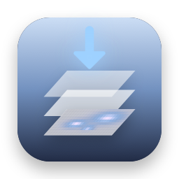
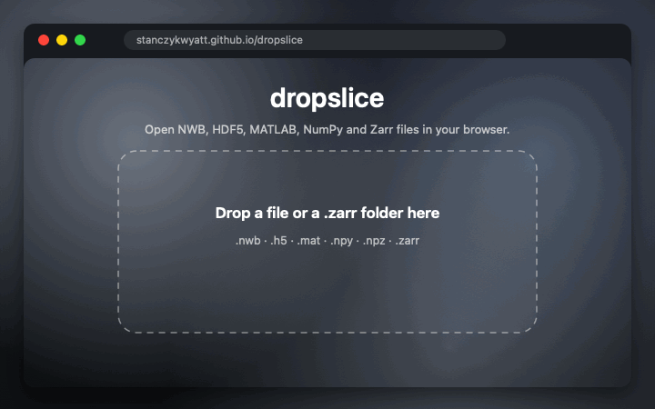

<p align="center">
  
</p>

<h1 align="center">dropslice</h1>

<p align="center">
  <b>Open NWB, HDF5, MATLAB, NumPy and Zarr files in your browser.</b><br>
  Drop a file, see what's inside, plot it, page through it. Nothing is uploaded: the page reads your file on your computer.
</p>

<p align="center">
  <a href="https://stanczykwyatt.github.io/dropslice/"><b>Open dropslice</b></a>
  &nbsp;·&nbsp;
  <a href="#what-it-opens">Formats</a>
  &nbsp;·&nbsp;
  <a href="https://github.com/users/stanczykwyatt/projects/1">Roadmap</a>
</p>

<p align="center">
  <a href="https://github.com/stanczykwyatt/dropslice/actions/workflows/ci.yml"></a>
  
  
  <a href="LICENSE"></a>
</p>

<p align="center">
  
</p>

---

Scientific data comes in a handful of formats, and each one has its own viewer, or none: HDF5 has h5web and HDFView, NWB has neurosift, NumPy and MATLAB files need Python or MATLAB, and Zarr needs code. To glance at a file someone sent you, you shouldn't have to install anything.

dropslice is one page that opens all of them. Drop a file on [stanczykwyatt.github.io/dropslice](https://stanczykwyatt.github.io/dropslice/) and browse its groups and arrays, with line plots, heatmaps, images and tables from [h5web](https://github.com/silx-kit/h5web). Big HDF5 files are read lazily, a slice at a time, so a multi-gigabyte recording opens in seconds. The file never leaves your computer.

If it saves you a trip to Python, [starring the repo](https://github.com/stanczykwyatt/dropslice/stargazers) helps other people find it.

## What it opens

| Format | Files | Notes |
|---|---|---|
| **NWB, HDF5** | `.nwb`, `.h5`, `.hdf5`, `.hdf`, `.he5` | Any size, read lazily. Compressed with gzip, Blosc, Blosc2, Zstandard, LZ4, LZF, bzip2, bitshuffle and others |
| **MATLAB v7.3** | `.mat` | It's HDF5 inside |
| **MATLAB v5** | `.mat` | What `save` writes by default: numbers, text, logicals, structs, cell arrays and complex numbers, in MATLAB's own dimensions. Sparse matrices show as MATLAB stores them: values, row indices and column starts |
| **NumPy** | `.npy`, `.npz` | Integers, floats (16 to 64 bits), complex numbers, booleans and text, in both memory orders and byte orders. Pickled object arrays are refused, never loaded; dates and structured arrays aren't supported yet |
| **Zarr** | `.zarr` folders | Zarr v2 and v3. Drop the folder, or open a public store by address |

Files are recognized by their first bytes, so a misnamed file still opens.

## Use it

- **Drop a file** on the page, or use **Choose a file**.
- **Zarr:** drop the `.zarr` folder, or use **Open a Zarr folder**.
- **Public data by link:** add `?url=` with an https address, like `https://stanczykwyatt.github.io/dropslice/?url=https://example.org/data.zarr/`. Zarr stores need consolidated metadata; other files are downloaded into the page, up to 1 GB, if their server allows it.
- **Offline:** save the page, or clone the repo and open `docs/index.html` through any static file server.

## Private by design

- **Nothing is uploaded.** dropslice is a static page on GitHub Pages with no server behind it. Your browser reads the file from your disk.
- **No cookies, storage, analytics or tracking.** The page only fetches its own files, plus the one address you give it with `?url=`.
- **A strict content security policy** keeps the page from loading code from anywhere else or sending forms.
- **Pickles are never loaded.** NumPy object arrays can run code when unpickled, so dropslice refuses them with a message.

More in [SECURITY.md](SECURITY.md).

## FAQ

**How is this different from h5web or myHDF5?**
dropslice is built on h5web's viewer, and for HDF5 files it works much like myHDF5. It adds MATLAB v5, NumPy and Zarr, and compression plugins like Blosc and Zstandard, in the same page.

**Can I open a MATLAB file without MATLAB?**
Yes, both v5 (the default) and v7.3. Structs and cell arrays become folders you can open, arrays keep MATLAB's dimensions, and text shows as text.

**How big a file can it open?**
HDF5, NWB and MATLAB v7.3 files of any size, because they're read a slice at a time. NumPy, MATLAB v5 and `.npz` files are read whole, so they're limited by your browser's memory, about 2 GB.

**Does it work on a phone?**
The page opens and files can be picked, but the viewer is made for a bigger screen.

## For developers

```bash
npm ci
npm run dev        # the page, with hot reload
npm test           # the format readers, in Node
npm run build      # the site, into docs/
```

The format readers in `src/formats/` are plain modules with no browser code, shared with SciLook, a Quick Look extension for the same files on the Mac (coming next). [CONTRIBUTING.md](CONTRIBUTING.md) has more.

## More free tools

- **[brainhound](https://github.com/stanczykwyatt/brainhound):** search and read public neuroscience data from your coding agent.
- **[symbolhop](https://github.com/stanczykwyatt/symbolhop)** and **[mulligan](https://github.com/stanczykwyatt/mulligan):** tools for coding agents.
- **[Who Stole My Focus](https://github.com/stanczykwyatt/who-stole-my-focus)**, **[Show Desktop](https://github.com/stanczykwyatt/show-desktop)** and **[Copy 2FA](https://github.com/stanczykwyatt/copy-2fa)** for the Mac.

## License

dropslice is released under the [MIT License](LICENSE) and is provided as is, without warranty of any kind. It bundles h5web, h5wasm, h5wasm-plugins, zarrita, numcodecs and React, whose licenses are in [THIRD_PARTY_NOTICES.txt](public/THIRD_PARTY_NOTICES.txt).

dropslice is an independent project, not affiliated with the HDF Group, MathWorks, NumPy, the Zarr project, the NWB project or the h5web team. MATLAB is a registered trademark of The MathWorks, Inc. The demo and example file use made-up data.
